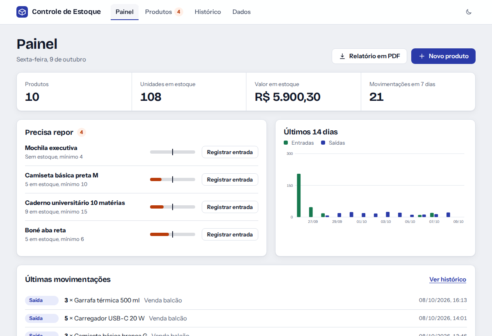
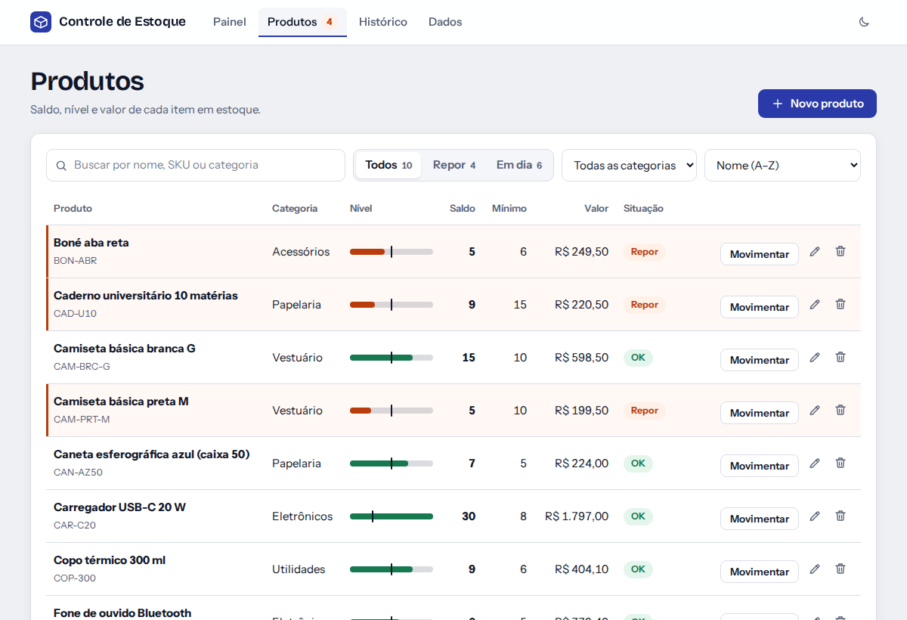
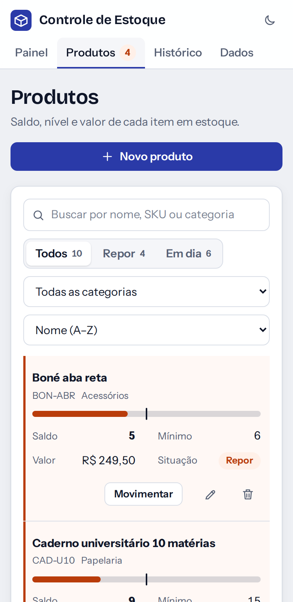

# Controle de Estoque

Sistema de controle de estoque para pequenos negócios. Cadastre produtos, registre entradas e saídas, veja na hora o que está acabando e baixe relatórios. Funciona direto no navegador, sem servidor e sem banco de dados.




## O que ele faz

- **Painel** com o resumo do estoque, a lista de produtos que precisam de reposição e um gráfico de entradas e saídas dos últimos 14 dias.
- **Produtos** com cadastro, edição, exclusão, busca (ignora acentos), filtro por situação e categoria e ordenação.
- **Barra de nível** em cada produto: o preenchimento mostra o saldo e o traço marca o estoque mínimo.
- **Entradas e saídas** com histórico completo. Uma saída maior que o saldo é bloqueada, e a tela mostra o saldo antes e depois de confirmar.
- **Estoque inicial** informado já no cadastro do produto.
- **Valor em estoque**, calculado pelo preço unitário de cada produto.
- **Relatório em PDF**, gerado no próprio navegador.
- **Exportação em CSV** (produtos e movimentações), pronta para abrir no Excel ou no Google Planilhas.
- **Backup e restauração** em JSON. Também importa o `data.json` da versão antiga do projeto.
- **Tema claro e escuro**, com layout que se adapta ao celular.
- **Dados de exemplo** para testar tudo em um clique.

<table>
  <tr>
    <td width="62%"></td>
    <td width="38%"></td>
  </tr>
</table>

## Tecnologias

| Parte | Tecnologia |
| --- | --- |
| Interface | React 18 e CSS puro |
| Build e dev server | Vite 6 |
| PDF | jsPDF e jsPDF-AutoTable (carregados só quando você pede o relatório) |
| Gráfico | SVG feito à mão, sem biblioteca |
| Fontes | Bricolage Grotesque e Instrument Sans, empacotadas no build |
| Testes | Test runner nativo do Node (`node:test`) |
| Hospedagem | Netlify |

## Como rodar no seu computador

Requisito: [Node.js](https://nodejs.org) 18 ou superior.

```bash
git clone https://github.com/IsaacMSilva/controle-estoque.git
cd controle-estoque
npm install
npm run dev
```

Abra o endereço que aparecer no terminal (normalmente http://localhost:5173).

| Comando | O que faz |
| --- | --- |
| `npm run dev` | Servidor de desenvolvimento com recarga automática |
| `npm run build` | Gera a versão de produção na pasta `dist` |
| `npm run preview` | Abre a versão de produção localmente |
| `npm test` | Roda os testes das regras de estoque |

## Onde ficam os dados

Os dados são salvos no `localStorage` do navegador. Isso significa que:

- Não existe conta nem servidor: nada sai do seu computador.
- Cada navegador (e cada aparelho) tem o seu próprio estoque.
- Limpar os dados do site no navegador apaga o estoque.

Por isso existe a aba **Dados**: baixe um backup de vez em quando e use-o para levar o estoque para outro computador. Se precisar de vários usuários ou de acesso de qualquer lugar, veja os próximos passos abaixo.

### Vindo da versão antiga (com servidor Express)

Na aba **Dados**, use **Restaurar de um arquivo** e escolha o antigo `server/data.json`. Produtos e histórico são importados e o preço unitário começa em zero.

## Estrutura

```
controle-estoque/
├── src/
│   ├── lib/
│   │   ├── estoque.js       # regras de negócio (saldo, validação, CSV, backup)
│   │   ├── format.js        # moeda, datas e download de arquivos
│   │   └── pdf.js           # relatório em PDF
│   ├── hooks/               # estado salvo, navegação e tema
│   ├── components/          # diálogos, formulários, gráfico, barra de nível
│   ├── views/               # Painel, Produtos, Histórico e Dados
│   ├── App.jsx
│   └── styles.css
├── tests/estoque.test.js    # testes das regras de negócio
├── public/                  # favicon e script do tema
├── netlify.toml             # configuração do deploy
└── .github/workflows/       # testes e build automáticos no GitHub
```

As regras de estoque ficam em `src/lib/estoque.js`, sem React nem DOM. Cada operação recebe os dados atuais e devolve novos dados (ou os erros de validação), o que deixa tudo fácil de testar.

## Próximos passos

- Trocar o `localStorage` por um banco na nuvem (Supabase, Firebase ou um backend próprio) para ter vários usuários
- Importar produtos por planilha CSV
- Leitura de código de barras pela câmera
- Lotes e data de validade
- Instalar como app (PWA) e funcionar offline

## Licença

Distribuído sob a licença MIT. Veja o arquivo [LICENSE](LICENSE).

Feito por [Isaac Mangelli Silva](https://github.com/IsaacMSilva).
